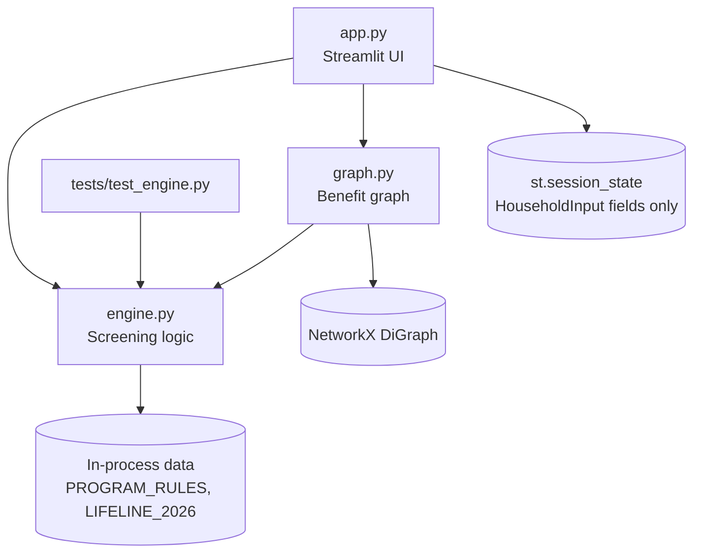

# Design Document

## Overview

BenefitChain AI is a single-process Streamlit application that helps Michigan residents screen for three government assistance programs: Lifeline, SNAP, and Michigan State Emergency Relief (SER). The application collects minimal household information through a main-content form (no sidebar), runs a pure-Python screening engine, renders a results dashboard with one card per program, and displays an interactive Plotly benefit graph showing how qualifying for one program can open pathways to others.

All program rules and income thresholds are stored as in-process Python constants. No external APIs, databases, authentication, or persistent storage are used. The app runs with `streamlit run app.py` on Python 3.11+ and completes end-to-end screening in under 3 seconds.

---

## Architecture

BenefitChain AI is structured as three Python modules: `engine.py` (pure screening logic), `graph.py` (NetworkX + Plotly graph construction), and `app.py` (Streamlit UI). The test suite exercises `engine.py` directly.



**Key architectural constraints:**
- `engine.py` has zero Streamlit imports and runs in a plain `pytest` environment.
- `graph.py` has zero Streamlit imports — it uses only `networkx` and `plotly`.
- `app.py` is the only file that imports `streamlit`. It calls engine and graph functions and renders results.
- All program rules and income tables are defined as Python constants inside `engine.py`; no external config files or network calls are needed at runtime.

**Project folder structure:**

```
BenefitChainAI/
├── app.py                  # Streamlit entry point (UI only)
├── engine.py               # Pure screening logic and data models
├── graph.py                # NetworkX + Plotly benefit graph (new file)
├── requirements.txt        # Pinned dependencies
├── README.md
├── tests/
│   └── test_engine.py      # pytest suite (no Streamlit import)
└── .kiro/
    └── specs/
        └── benefitchain/
            ├── requirements.md
            └── design.md
```

`graph.py` is a new file that must be created. It does not exist in the current repository.

---

## Components and Interfaces

### `engine.py` — Screening Engine

The engine is a collection of pure Python functions and frozen dataclasses with no Streamlit dependency.

**Public interface:**

```python
# Input
def screen(h: HouseholdInput) -> list[ScreeningResult]: ...

# Income threshold helper
def lifeline_income_limit(size: int) -> int: ...

# Dataclasses (exported)
HouseholdInput, LifelineStatus, ProgramRule, SavingsRange, ScreeningResult

# Backward-compat alias
Household = HouseholdInput
```

`screen()` always returns a list of exactly three `ScreeningResult` instances in the order: `[0]` Lifeline, `[1]` SNAP, `[2]` SER.

**Constants (exported):**

```python
LIFELINE_STANDARD_MONTHLY_MAX: float = 9.25
LIFELINE_STANDARD_ANNUAL_MAX: float = 111.0
LIFELINE_SAVINGS_NOTE: str
LIFELINE_RULE: ProgramRule
SNAP_RULE: ProgramRule
SER_RULE: ProgramRule
```

---

### `graph.py` — Benefit Graph

**Public interface:**

```python
def build_benefit_graph(
    household: HouseholdInput,
    results: list[ScreeningResult],
) -> nx.DiGraph: ...

def render_benefit_graph(
    household: HouseholdInput,
    results: list[ScreeningResult],
) -> go.Figure: ...
```

Both functions accept `HouseholdInput` and `list[ScreeningResult]` as parameters. `household.snap` and `household.medicaid` determine whether SNAP and Medicaid nodes are highlighted as "already_receiving." `results[0]` (Lifeline) and `results[2]` (SER) determine their node states.

`render_benefit_graph` calls `build_benefit_graph` internally and returns a `go.Figure` suitable for `st.plotly_chart()`.

---

### `app.py` — Streamlit UI

**Public interface:** None — this is an executable Streamlit script, not a library.

**Page configuration:**

```python
st.set_page_config(
    page_title="BenefitChain AI",
    page_icon="🔗",
    layout="centered",   # NOT "wide" — supports 320px+ viewports
)
```

No `st.sidebar` is used anywhere. All inputs are in the main content area.

**Page layout (top to bottom):**

```
[Title + caption]
[Privacy notice — displayed above the form]
[Questionnaire form]
  [Household size input]
  [Annual income input]
  [Program checkboxes]
  [Energy emergency checkbox]
  ["Try sample household" button]
  ["Screen my household" submit button]
[Results dashboard — rendered after submission]
  [Summary metrics]
  [Program cards × 3]
[Benefit graph]
  [Plotly figure]
  ["Benefit Domino Effect" explanation text]
[Footer disclaimer]
[Official resources links]
```

**Privacy notice constant (rendered verbatim above the form):**

```python
PRIVACY_NOTICE = (
    "BenefitChain AI uses the information you enter to provide preliminary benefit "
    "screening. Your responses are processed by the application server during your "
    "session. We do not ask for names, Social Security numbers, or case numbers, and "
    "the application is designed not to save household profiles to a permanent "
    "database. Please do not enter sensitive identifying information."
)
```

**Footer disclaimer constant:**

```python
FOOTER_DISCLAIMER = (
    "This tool provides preliminary screening only. Results are not an official "
    "eligibility determination. Contact the program directly to apply."
)
```

**Session state keys** (the only data stored in `st.session_state`):

| Key | Type | Description |
|---|---|---|
| `household_size` | `int` | Number of people in household |
| `annual_income` | `float` | Approximate gross annual income |
| `snap` | `bool` | SNAP participation |
| `medicaid` | `bool` | Medicaid participation |
| `ssi` | `bool` | SSI participation |
| `public_housing` | `bool` | Federal public housing assistance |
| `veterans_pension` | `bool` | Veterans/survivors pension |
| `utility_emergency` | `bool` | Active energy emergency |
| `lifeline_already` | `bool` | Currently receiving Lifeline |

**"Try sample household" behavior** (Requirement 1.2–1.3): sets `household_size=3`, `annual_income=28000`, `snap=True`, `medicaid=True`, all other checkboxes `False`, `utility_emergency=False`; displays `"Demo data loaded — this is a fictional household for illustration."` Does not auto-submit.

**Input validation** (UI layer, before calling `screen()`):
- `household_size` not a positive integer → `st.error(...)`, do not call `screen()`.
- `annual_income` negative → `st.error(...)`, do not call `screen()`.

**Savings display** (UI formatting function in `app.py`):

```python
def format_savings(sr: SavingsRange) -> str:
    return (
        f"Up to ${sr.monthly_max:.2f}/month (${sr.annual_max:.0f}/year) — {sr.note}"
    )
```

This keeps numeric values in the engine and all string formatting in the UI layer.

---

## Data Models

All dataclasses are defined in `engine.py` and imported by `graph.py` and `app.py`.

### `HouseholdInput`

```python
@dataclass(frozen=True)
class HouseholdInput:
    state: str
    size: int                       # positive integer
    annual_income: float            # non-negative
    snap: bool = False
    medicaid: bool = False
    ssi: bool = False
    public_housing: bool = False
    veterans_pension: bool = False
    utility_emergency: bool = False
    lifeline_already: bool = False

# Backward-compatibility alias for existing imports and tests
Household = HouseholdInput
```

### `LifelineStatus`

A `str` enum with exactly five values matching the five Status Codes from Requirement 2:

```python
from enum import Enum

class LifelineStatus(str, Enum):
    LIKELY_QUALIFIES_INCOME  = "LIKELY_QUALIFIES_INCOME"
    LIKELY_QUALIFIES_PROGRAM = "LIKELY_QUALIFIES_PROGRAM"
    ALREADY_RECEIVING        = "ALREADY_RECEIVING"
    NOT_INDICATED            = "NOT_INDICATED"
    INCOMPLETE_DATA          = "INCOMPLETE_DATA"
```

Using `str` as the base class preserves string comparison compatibility with existing test code.

### `ProgramRule`

```python
@dataclass(frozen=True)
class ProgramRule:
    name: str               # e.g., "Lifeline phone / internet discount"
    source_url: str         # official program URL (https://)
    effective_year: int     # e.g., 2026
    policy_review_date: str # ISO 8601, e.g., "2026-11-22"
```

One instance per program, defined as module-level constants in `engine.py`.

### `SavingsRange`

```python
@dataclass(frozen=True)
class SavingsRange:
    monthly_max: float   # e.g., 9.25  (dollars)
    annual_max: float    # e.g., 111.0 (dollars)
    note: str            # human-readable caveat
```

SNAP and SER always have `savings_range=None`. The engine never estimates their dollar value. The UI formats `SavingsRange` via `format_savings()` in `app.py` — the engine does not produce display strings.

### `ScreeningResult`

```python
@dataclass(frozen=True)
class ScreeningResult:
    rule: ProgramRule
    status: LifelineStatus | str   # LifelineStatus for Lifeline; str for SNAP/SER
    explanation: str               # plain-English reason, no forbidden words
    steps: list[str]               # imperative action items
    savings_range: Optional[SavingsRange] = None
```

`status` is `LifelineStatus | str` to accommodate SNAP/SER statuses (`"needs_review"`, `"already_receiving"`, `"urgent_referral"`) without forcing them into the Lifeline enum.

### Engine constants

```python
# Income thresholds — USAC 2026, 135% FPG
LIFELINE_2026: dict[int, int] = {
    1: 21546, 2: 29214, 3: 36882, 4: 44550,
    5: 52218, 6: 59886, 7: 67554, 8: 75222,
}
LIFELINE_PER_ADDITIONAL_PERSON: int = 7668

# Standard Lifeline discount — Tribal-land enhanced benefit NOT included
# (this MVP does not collect Tribal-land data)
LIFELINE_STANDARD_MONTHLY_MAX: float = 9.25
LIFELINE_STANDARD_ANNUAL_MAX: float = 111.0
LIFELINE_SAVINGS_NOTE: str = (
    "actual discount depends on service provider and program rules"
)

LIFELINE_RULE = ProgramRule(
    name="Lifeline phone / internet discount",
    source_url="https://www.usac.org/lifeline/consumer-eligibility/",
    effective_year=2026,
    policy_review_date="2026-11-22",
)
SNAP_RULE = ProgramRule(
    name="Michigan Food Assistance Program (SNAP)",
    source_url="https://www.michigan.gov/mdhhs/assistance-programs/food/eligibility",
    effective_year=2026,
    policy_review_date="2026-11-22",
)
SER_RULE = ProgramRule(
    name="Michigan State Emergency Relief (energy)",
    source_url="https://www.michigan.gov/mdhhs/assistance-programs/emergency-relief/eligibility",
    effective_year=2026,
    policy_review_date="2026-11-22",
)
```

### `lifeline_income_limit(size: int) -> int`

```python
def lifeline_income_limit(size: int) -> int:
    """Return the 2026 Lifeline 135% FPG annual income threshold.

    Args:
        size: Positive integer household size.

    Returns:
        Annual income threshold in whole dollars.

    Raises:
        ValueError: If size < 1.
    """
    if size < 1:
        raise ValueError("Household size must be at least 1")
    if size <= 8:
        return LIFELINE_2026[size]
    return LIFELINE_2026[8] + (size - 8) * LIFELINE_PER_ADDITIONAL_PERSON
```

The formula `21546 + (size - 1) * 7668` produces identical values to the lookup table for sizes 1–8 and extends correctly beyond 8.

### `screen()` Lifeline decision table

| Condition (evaluated in order) | `status` | `savings_range` |
|---|---|---|
| `h.lifeline_already is True` | `ALREADY_RECEIVING` | `None` |
| Any qualifying program flag is `True` | `LIKELY_QUALIFIES_PROGRAM` | `SavingsRange(9.25, 111.0, LIFELINE_SAVINGS_NOTE)` |
| `h.annual_income <= lifeline_income_limit(h.size)` | `LIKELY_QUALIFIES_INCOME` | `SavingsRange(9.25, 111.0, LIFELINE_SAVINGS_NOTE)` |
| Otherwise | `NOT_INDICATED` | `None` |

Qualifying programs: `snap`, `medicaid`, `ssi`, `public_housing`, `veterans_pension`.

The `explanation` for `ALREADY_RECEIVING` must contain "one benefit per household." No explanation string anywhere may use "eligible," "approved," or "guaranteed."

### `screen()` SNAP and SER decision tables

**SNAP:**

| Condition | `status` | `savings_range` |
|---|---|---|
| `h.snap is True` | `"already_receiving"` | `None` |
| Otherwise | `"needs_review"` | `None` |

SNAP `explanation` must include the Requirement 3.5 disclaimer and must not contain a numeric dollar benefit amount.

**SER:**

| Condition | `status` | `savings_range` |
|---|---|---|
| `h.utility_emergency is True` | `"urgent_referral"` | `None` |
| Otherwise | `"needs_review"` | `None` |

SER `explanation` must not use "approved," "guaranteed," or "will receive."

### `build_benefit_graph` node state table

| Node | Condition | State |
|---|---|---|
| SNAP | `household.snap is True` | `"already_receiving"` |
| SNAP | `household.snap is False` | `"not_indicated"` |
| Medicaid | `household.medicaid is True` | `"already_receiving"` |
| Medicaid | `household.medicaid is False` | `"not_indicated"` |
| Lifeline | `results[0].status in (LIKELY_QUALIFIES_INCOME, LIKELY_QUALIFIES_PROGRAM)` | `"qualifies"` |
| Lifeline | `results[0].status == ALREADY_RECEIVING` | `"already_receiving"` |
| Lifeline | Otherwise | `"not_indicated"` |
| SER | `results[2].status == "urgent_referral"` | `"qualifies"` |
| SER | Otherwise | `"not_indicated"` |

Edges (always present): SNAP → Lifeline (`"Proof of SNAP participation required"`), Medicaid → Lifeline (`"Proof of Medicaid participation required"`). All edges carry `pathway=True`.

Nodes are distinguished by both color and text label suffix (Requirement 5.4):
- `"qualifies"` → green / `"(Potential Pathway)"`
- `"already_receiving"` → blue / `"(Already Receiving)"`
- `"not_indicated"` → gray / `"(Not Indicated)"`

---

## Correctness Properties

*A property is a characteristic or behavior that should hold true across all valid executions of a system — essentially, a formal statement about what the system should do. Properties serve as the bridge between human-readable specifications and machine-verifiable correctness guarantees.*

### Property 1: Income threshold formula is universal

*For any* positive integer household size, `lifeline_income_limit(size)` equals `21546 + (size - 1) * 7668`.

**Validates: Requirements 2.1**

### Property 2: Any single qualifying program triggers LIKELY_QUALIFIES_PROGRAM regardless of income

*For any* household with income above the Lifeline threshold and exactly one of `{snap, medicaid, ssi, public_housing, veterans_pension}` set to `True` (others `False`), `screen(h)[0].status` equals `LIKELY_QUALIFIES_PROGRAM`.

**Validates: Requirements 2.2, 2.6**

### Property 3: Lifeline status is always a member of the five-value enum

*For any* valid `HouseholdInput`, `screen(h)[0].status` is one of `{LIKELY_QUALIFIES_INCOME, LIKELY_QUALIFIES_PROGRAM, ALREADY_RECEIVING, NOT_INDICATED, INCOMPLETE_DATA}`.

**Validates: Requirements 2.3**

### Property 4: lifeline_already always produces ALREADY_RECEIVING

*For any* `HouseholdInput` with `lifeline_already=True`, regardless of income, household size, or program flags, `screen(h)[0].status` equals `ALREADY_RECEIVING`.

**Validates: Requirements 2.4**

### Property 5: Income at or below threshold with no programs produces LIKELY_QUALIFIES_INCOME

*For any* household size and income value where `income <= lifeline_income_limit(size)`, with all program flags `False` and `lifeline_already=False`, `screen(h)[0].status` equals `LIKELY_QUALIFIES_INCOME`.

**Validates: Requirements 2.5**

### Property 6: Income above threshold with no programs produces NOT_INDICATED

*For any* household where `income > lifeline_income_limit(size)`, all program flags `False`, and `lifeline_already=False`, `screen(h)[0].status` equals `NOT_INDICATED`.

**Validates: Requirements 2.7**

### Property 7: SER status reflects utility_emergency flag universally

*For any* `HouseholdInput` with `utility_emergency=True`, `screen(h)[2].status` equals `"urgent_referral"`. *For any* `HouseholdInput` with `utility_emergency=False`, `screen(h)[2].status` does not equal `"urgent_referral"`.

**Validates: Requirements 4.1, 4.2**

### Property 8: SNAP result never contains a numeric dollar estimate

*For any* `HouseholdInput`, `screen(h)[1].explanation` does not match the regex pattern `\$\d+` and `screen(h)[1].savings_range` is `None`.

**Validates: Requirements 3.3**

### Property 9: ProgramRule instances always carry all required fields

*For any* `ProgramRule` in `PROGRAM_RULES`, `rule.name` is non-empty, `rule.source_url` starts with `"https://"`, `rule.effective_year > 0`, and `rule.policy_review_date` matches ISO 8601 format `YYYY-MM-DD`.

**Validates: Requirements 2.10**

---

## Error Handling

### Engine validation

`screen()` validates inputs before any logic runs:

```python
if not isinstance(h.size, int) or h.size < 1:
    raise ValueError("Household size must be a positive integer")
if h.annual_income < 0:
    raise ValueError("Annual income must be non-negative")
```

This covers Requirement 2.8 (size < 1, negative income) and test scenarios 7.3–7.5 (size=0, size=-1, non-integer size=2.5). The `ValueError` propagates to the caller; `app.py` catches it and displays an `st.error()` message.

Non-Michigan state inputs return a single `ScreeningResult` with `status="out_of_scope"` rather than raising.

### UI validation

`app.py` performs a UI-layer check before calling `screen()`:
- Non-positive or non-integer household size → `st.error(...)`, block submission.
- Negative income → `st.error(...)`, block submission.

This provides inline feedback (Requirement 1.4–1.5) without relying on exception display.

### Graph rendering

`render_benefit_graph` will not raise for any valid `ScreeningResult` list. If `results` is empty or malformed, the function logs a warning and returns an empty figure rather than crashing the page.

### Privacy safeguards (data handling constraints)

- Streamlit session state is held in **server-side memory** (the Streamlit server process), not exclusively in the browser. It persists for the lifetime of the browser session as defined by Streamlit's internal session management.
- The app stores only the nine `HouseholdInput` fields listed in the session state key table above.
- No names, Social Security numbers, case numbers, addresses, phone numbers, or email addresses are collected or stored (Requirement 8.1).
- No data is written to any file, database, or external service (Requirement 8.2).
- The design does **not** claim data is deleted when the tab closes — tab-close behavior depends on Streamlit's session timeout, which the application does not control (Requirement 8.4).
- The design does **not** make claims about network proxy logs, server deletion timing, or infrastructure behavior that cannot be verified from the application's Streamlit source code (Requirement 8.5).

---

## Testing Strategy

### Unit and integration tests (required)

All 10 test scenarios from Requirement 7 are implemented as explicit `pytest` functions in `tests/test_engine.py`. The suite runs with `pytest tests/` and produces no Streamlit import errors.

| Test function | Requirement 7 AC | Scenario |
|---|---|---|
| `test_income_at_threshold_qualifies` | 7.1 | `size=1, income=21546` → `LIKELY_QUALIFIES_INCOME` |
| `test_income_one_above_threshold` | 7.2 | `size=1, income=21547` → `NOT_INDICATED` |
| `test_size_zero_invalid` | 7.3 | `size=0` → `ValueError` or `INCOMPLETE_DATA` |
| `test_size_negative_invalid` | 7.4 | `size=-1` → `ValueError` or `INCOMPLETE_DATA` |
| `test_non_integer_size_invalid` | 7.5 | `size=2.5` → `ValueError` or `INCOMPLETE_DATA` |
| `test_already_receiving_lifeline` | 7.6 | `lifeline_already=True` → `ALREADY_RECEIVING`, explanation contains "one benefit per household" |
| `test_snap_participation_above_threshold` | 7.7 | `income=60000, snap=True` → `LIKELY_QUALIFIES_PROGRAM` |
| `test_snap_result_no_dollar_estimate` | 7.8 | SNAP `explanation` and `savings_range` contain no numeric dollar amount |
| `test_ser_result_no_forbidden_words` | 7.9 | SER `explanation` does not contain "approved," "guaranteed," or "will receive" |
| `test_no_streamlit_import` | 7.10 | `import engine` succeeds; `import streamlit` not triggered |

**Updated test signatures** (migrating from dict to dataclass access):

```python
# Before (dict-based, current test_engine.py):
result = screen(Household('Michigan', 2, 60000, snap=True))[0]
assert result['status'] == 'strong_pathway'
assert result['annual_max'] == 111

# After (dataclass-based):
result = screen(HouseholdInput('Michigan', 2, 60000, snap=True))[0]
assert result.status == LifelineStatus.LIKELY_QUALIFIES_PROGRAM
assert result.savings_range.annual_max == 111.0
```

During migration, `Household = HouseholdInput` alias in `engine.py` keeps existing test imports valid. `screen()` returning `list[ScreeningResult]` requires updating attribute access from `result['key']` to `result.key`.

### Property-based tests (optional)

Property-based tests using `hypothesis` are **optional** and not required for the hackathon MVP. If `hypothesis` is installed, the nine correctness properties from the Correctness Properties section can be automated:

```python
# Optional — requires: pip install hypothesis>=6.100
# Feature: benefitchain, Property 1: income threshold formula is universal
from hypothesis import given, settings
from hypothesis import strategies as st as hst

@given(size=hst.integers(min_value=1, max_value=50))
@settings(max_examples=100)
def test_income_threshold_formula_property(size):
    assert lifeline_income_limit(size) == 21546 + (size - 1) * 7668
```

Each property test must run at minimum 100 iterations (`max_examples=100`). Do not add `hypothesis` to the required `requirements.txt`.

### Dependencies

**Required:**

```
streamlit>=1.38,<2
networkx>=3.3
plotly>=5.22
pytest>=8,<10
```

Add `networkx` and `plotly` to `requirements.txt`. The current file lists only `streamlit` and `pytest`.

**Optional:**

```
hypothesis>=6.100   # property-based testing (not required for MVP)
```

---

## MVP Constraints

| Constraint | Specification |
|---|---|
| **External services** | None — no paid APIs, external databases, or authentication (Requirement 9.1) |
| **Program rules storage** | In-process Python dicts/dataclasses in `engine.py`; no config files required at runtime (Requirement 9.2) |
| **Screening latency** | Full `screen()` + graph render completes in under 3 seconds on a standard laptop under no load (Requirement 9.3) |
| **Demo duration** | End-to-end demo (form entry → results → graph) completable within 3 minutes (Requirement 9.5) |
| **Launch command** | `streamlit run app.py` — no Docker, no background services |
| **Python version** | 3.11+ (uses `list[dict]` and `X \| Y` union type syntax) |
| **RAM** | Fits comfortably within 8 GB; NetworkX graph has 4 nodes and 2 edges |
| **Viewport support** | `layout="centered"` with single-column form renders correctly at 320px+ width (Requirement 1.7) |
| **Keyboard navigation** | All form fields reachable by Tab; submit via Enter or button click (Requirement 1.8) |
| **Policy Review Date** | Displayed per program card in the results dashboard; hardcoded to `"2026-11-22"` in `ProgramRule` constants (Requirement 6.6, 9.4) |
